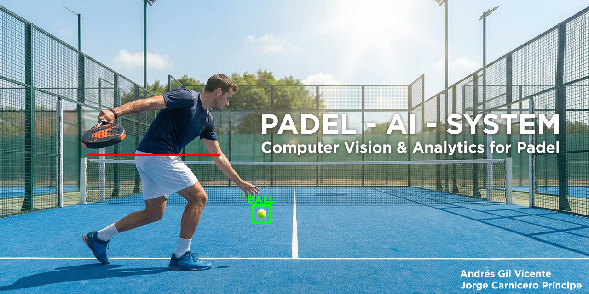

<div align="center">
  
  <a href="https://github.com/jorgecarnicero/ProyectoFinalComputerVision">
    
  </a>

  <h1>🎾 Padel AI System</h1>
  <p><strong>Computer Vision applied to Security and Sports Analysis</strong></p>

  <p>
    <a href="https://www.python.org/">
      
    </a>
    <a href="https://streamlit.io/">
      
    </a>
    <a href="https://opencv.org/">
      
    </a>
    <a href="https://ultralytics.com/yolov8">
      
    </a>
  </p>
</div>

<hr />


## 📖 Introduction

**Padel AI System** is a comprehensive Computer Vision project developed for the *Computer Vision I* course at **Universidad Pontificia Comillas (ICAI)**.

This system implements a two-module solution using a single mobile device camera:
1.  **Security System:** An access control module based on geometric pattern recognition that acts as a visual password.
2.  **Tracking System (AI Chair Umpire):** An autonomous sports analysis engine capable of tracking a padel ball, detecting players via pose estimation, and validating serves (Valid/Fault) in real-time.

## 📂 Repository Structure

The project is organized into modular directories to ensure scalability and order:

```text
├── 📂 assets/                   # Images and visual content, e.g., for the ReadMe.md banner
├── 📂 calibration_process/      # Scripts and images for intrinsic camera calibration
├── 📂 complete_padel_system/    # Unified application integrating Security + Tracker
├── 📂 security_system/          # Independent geometric pattern recognition module
├── 📂 tracking_system/          # Independent ball tracking and umpire logic module
├── 📄 .gitignore                # Git configuration
├── 📄 ReadMe.md                 # Project documentation
└── 📄 documentation.pdf         # Final report and project documentation
└── 📄 requirements.txt          # Dependencies and required libraries

```

## 🛠️ Technologies and Methodology

The system relies on a hybrid approach combining **Classical Computer Vision** and advanced algorithms such as those offered by the **YOLO** library:

* **Core Framework:** Python 3, OpenCV (cv2).
* **Deep Learning:** YOLOv8-Pose (Ultralytics) for player keypoint extraction (waist/feet).
* **Classical Techniques:**
  * HSV color segmentation and MOG2 background subtraction for ball detection.
  * Optical Flow (Lucas-Kanade) for trajectory smoothing.
  * Kalman Filters for state prediction and occlusion handling.
  * Geometric approximation (Douglas-Peucker) on the *Convex Hull* for the security module.
  * Use of morphological operations, thresholding, binarization, etc.


* **Interface:** Streamlit for the web dashboard and real-time visualization.
* **Optimization:** Multithreading for video capture and optional TensorRT support for inference.

## 🚀 Installation and Setup

### Prerequisites

Ensure you have **Python 3.9** or higher installed.

### 1. Clone the Repository

```bash
git clone https://github.com/andresgilvicente/padel-ai-system.git


```

### 2. Create Virtual Environment (Recommended)

```bash
python -m venv venv # On Windows

.\venv\Scripts\activate # On Mac/Linux

source venv/bin/activate


```

### 3. Install Dependencies

All necessary libraries are listed in `requirements.txt`.

```bash
pip install -r requirements.txt


```

## 🖥️ Execution

You can run the modules independently or as a complete system.

### Option A: Complete System (Security + Tracker)

Executes the full flow. You must pass the security check (show 4 geometric shapes) to unlock the tracker.

```bash
streamlit run complete_padel_system/complete_padel_system_app.py


```

### Option B: Tracking System (Umpire Only)

Launches the AI Chair Umpire directly for analysis or debugging.

```bash
streamlit run tracking_system/tracking_system_app.py


```

### Option C: Security System

Tests the geometric pattern recognition logic in isolation.

```bash
streamlit run security_system/security_system_app.py


```

## 📊 Feature Description

🔒 Security Module

* **Shape Detection:** Identifies Lines, Triangles, Squares, Rectangles, Circles, and Pentagons using contour analysis and *convex hulls*.
* **Sequence Decoder:** Unlocks the system only when a specific sequence of 4 predefined geometric shapes is detected.

🎾 Tracking Module (AI Umpire)

* **Ball Tracking:** Hybrid detection using Color/Motion + Kalman Filter Prediction.
* **Serve Validation:**
  * Detects serve impact based on acceleration peaks.
  * Compares ball height vs. player waist height (YOLO Keypoints).
  * Classifies the serve as **VALID** or **FAULT**.


* **Bounce Detection:** Analyzes the trajectory on the Y-axis to detect direction changes (bounces) on the court.
* **Evidence Generation:** Automatically saves "Photo Finish" frames of each analyzed serve.

## 👥 Authors

* **Jorge Carnicero Príncipe**
* **Andrés Gil Vicente**

*Completion Date: January 10, 2026*

